# Диаграмма классов

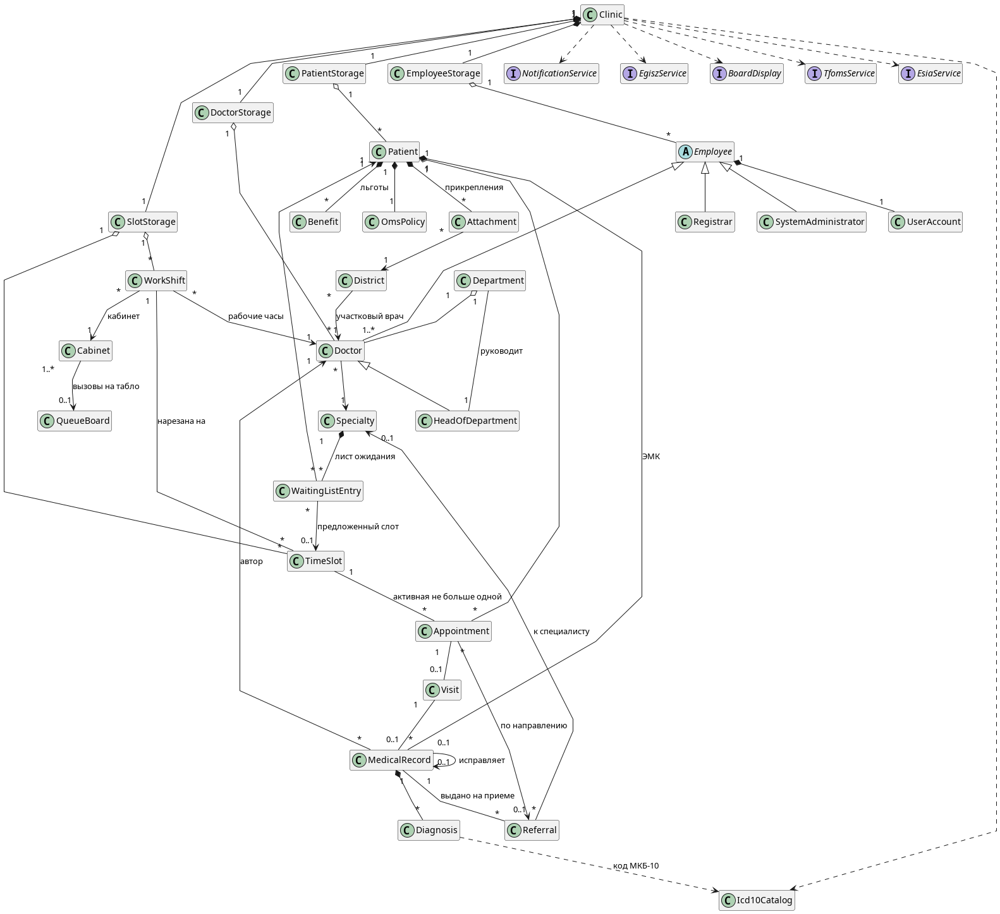

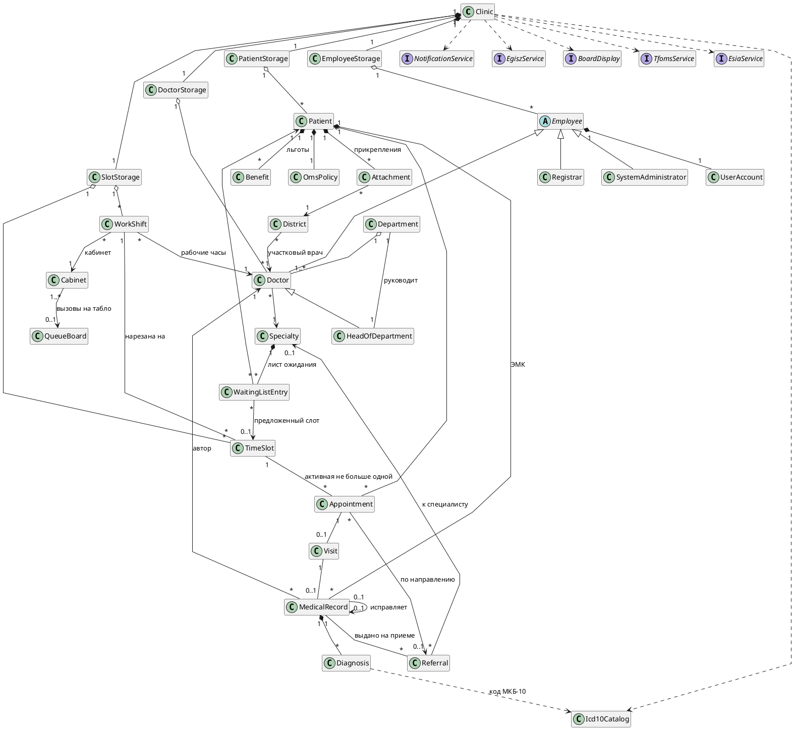

## 1. Поликлиника и хранилища

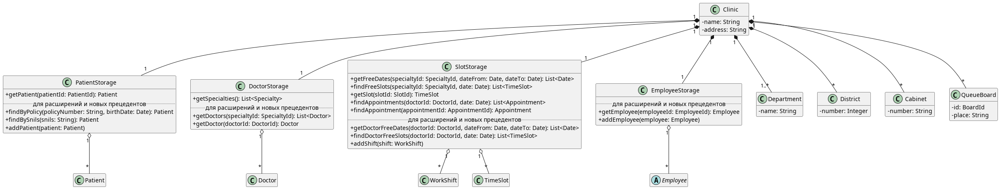

```plantuml
@startuml classes-clinic
skinparam classAttributeIconSize 0
hide empty members

class Clinic {
  - name: String
  - address: String
}
class PatientStorage {
  + getPatient(patientId: PatientId): Patient
  .. для расширений и новых прецедентов ..
  + findByPolicy(policyNumber: String, birthDate: Date): Patient
  + findBySnils(snils: String): Patient
  + addPatient(patient: Patient)
}
class DoctorStorage {
  + getSpecialties(): List<Specialty>
  .. для расширений и новых прецедентов ..
  + getDoctors(specialtyId: SpecialtyId): List<Doctor>
  + getDoctor(doctorId: DoctorId): Doctor
}
class SlotStorage {
  + getFreeDates(specialtyId: SpecialtyId, dateFrom: Date, dateTo: Date): List<Date>
  + findFreeSlots(specialtyId: SpecialtyId, date: Date): List<TimeSlot>
  + getSlot(slotId: SlotId): TimeSlot
  + findAppointments(doctorId: DoctorId, date: Date): List<Appointment>
  + findAppointment(appointmentId: AppointmentId): Appointment
  .. для расширений и новых прецедентов ..
  + getDoctorFreeDates(doctorId: DoctorId, dateFrom: Date, dateTo: Date): List<Date>
  + findDoctorFreeSlots(doctorId: DoctorId, date: Date): List<TimeSlot>
  + addShift(shift: WorkShift)
}
class EmployeeStorage {
  .. для расширений и новых прецедентов ..
  + getEmployee(employeeId: EmployeeId): Employee
  + addEmployee(employee: Employee)
}
class Department {
  - name: String
}
class District {
  - number: Integer
}
class Cabinet {
  - number: String
}
class QueueBoard {
  - id: BoardId
  - place: String
}
class Patient
class Doctor
class WorkShift
class TimeSlot
abstract class Employee

Clinic "1" *-down- "1" PatientStorage
Clinic "1" *-down- "1" DoctorStorage
Clinic "1" *-down- "1" SlotStorage
Clinic "1" *-down- "1" EmployeeStorage
PatientStorage "1" o-down- "*" Patient
DoctorStorage "1" o-down- "*" Doctor
SlotStorage "1" o-down- "*" WorkShift
SlotStorage "1" o-down- "*" TimeSlot
EmployeeStorage "1" o-down- "*" Employee
Clinic "1" *-- "1..*" Department
Clinic "1" *-- "*" District
Clinic "1" *-- "*" Cabinet
Clinic "1" *-- "*" QueueBoard

@enduml
```

## 2. Сотрудники и учетные записи

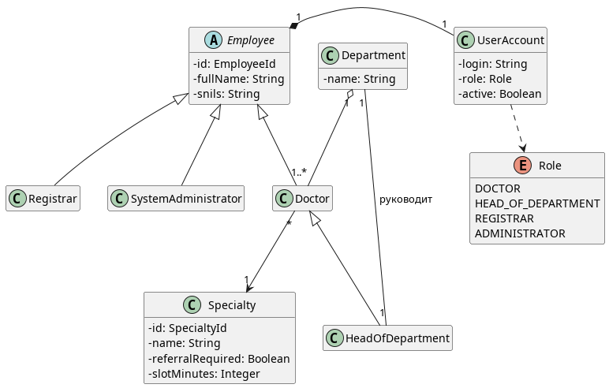

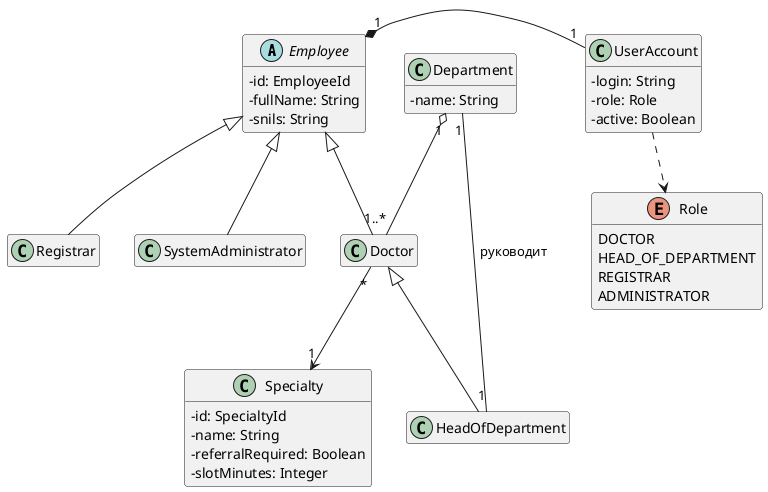

## 3. Пациент, прикрепление и льготы

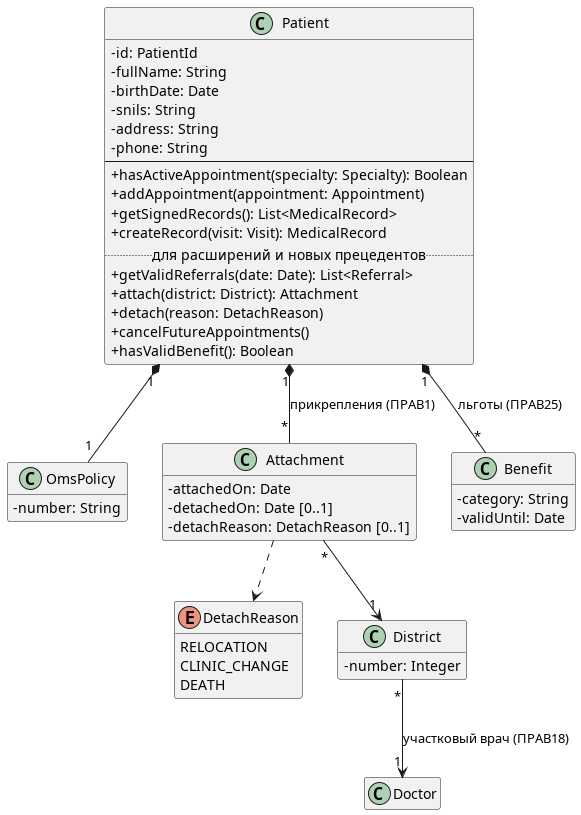

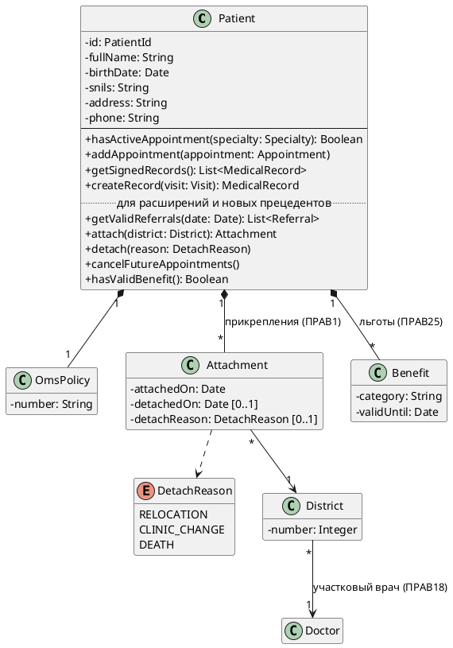

## 4. Расписание и запись на прием

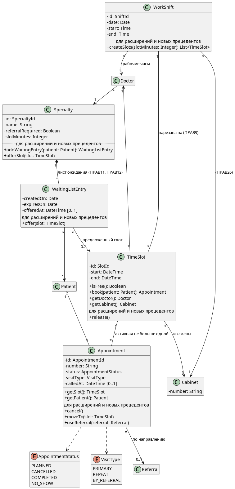

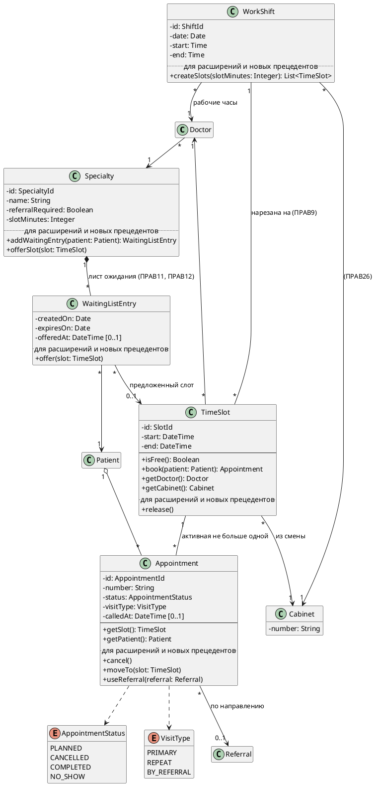

## 5. Кабинеты и табло

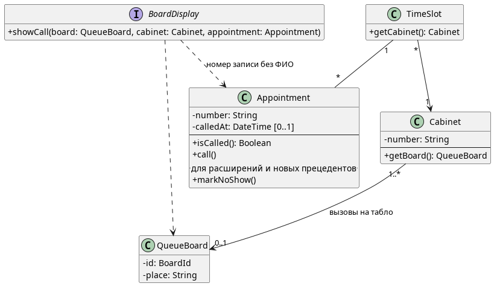

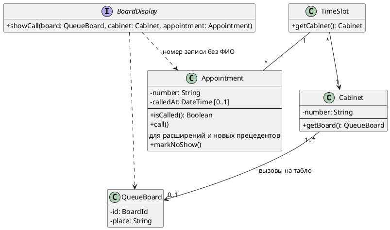

## 6. Прием и медицинская карта

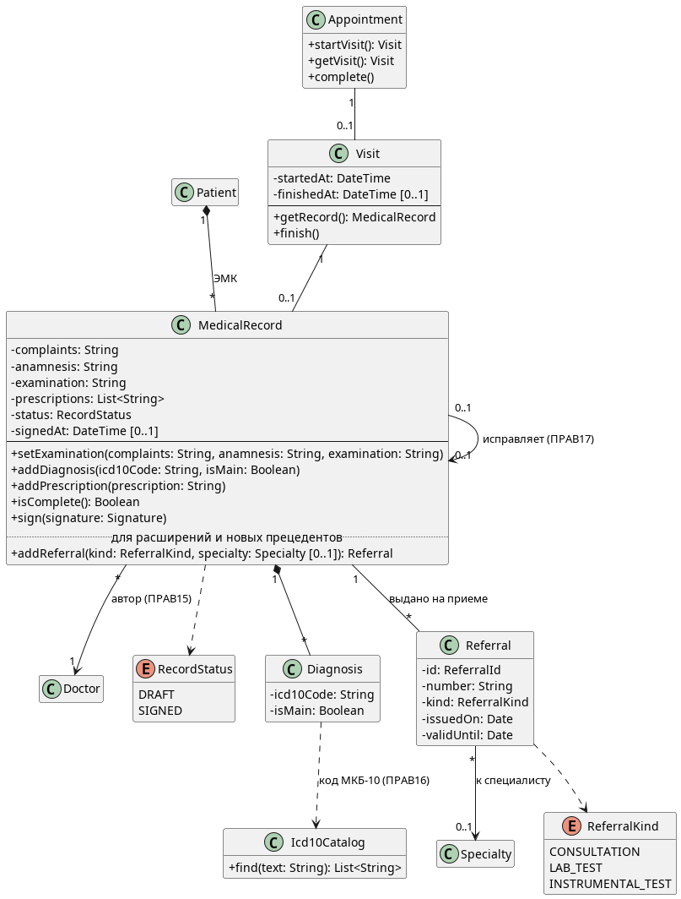

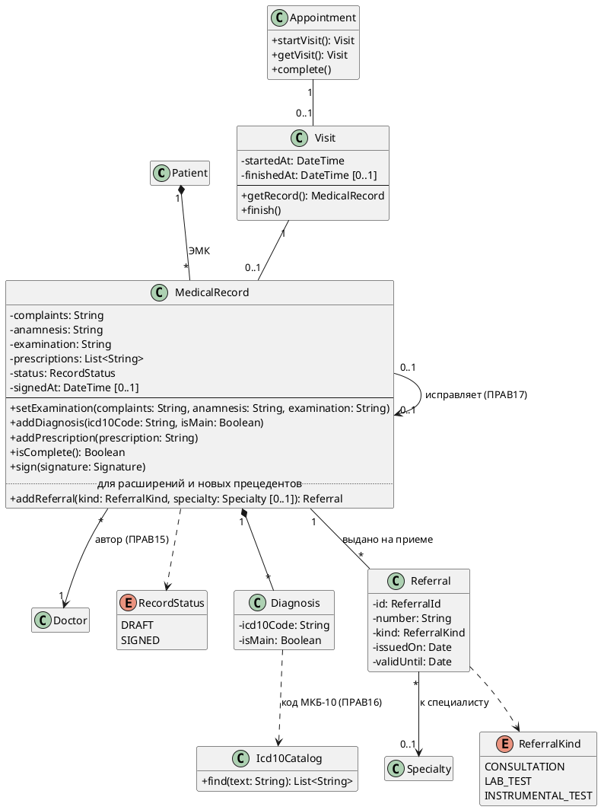

## 7. Системные операции и интерфейсы

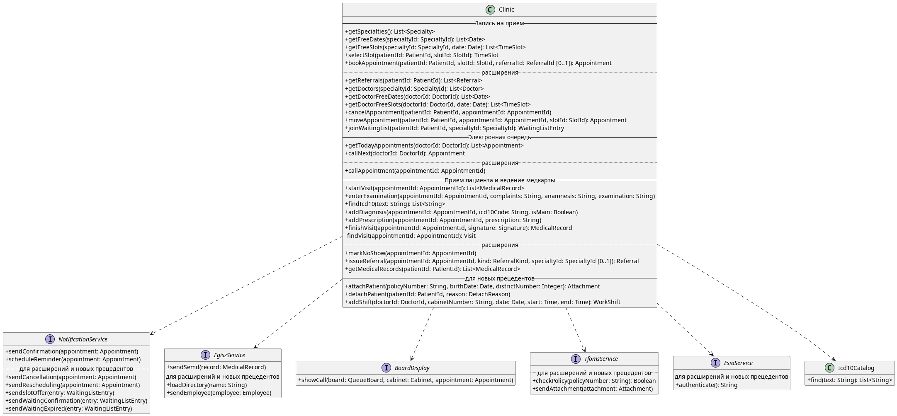

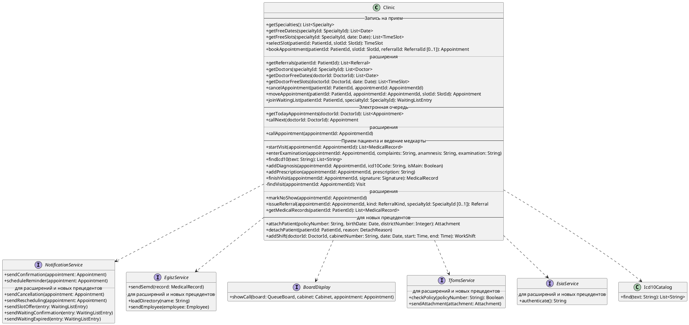
