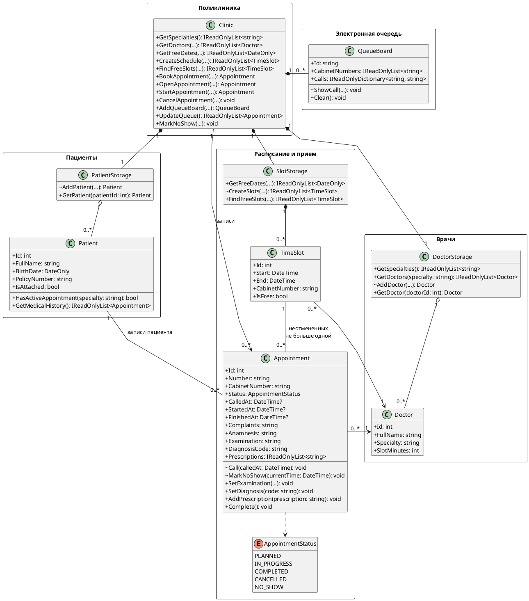

# Диаграмма классов ИС «ПолиКлик»

Показано ядро из `src/PoliClick`: запись пациента, ведение приема и автоматическая очередь. На диаграмме оставлены основные свойства и методы; параметры части методов сокращены до `...`. Медицинская история пациента состоит из завершенных `Appointment`.

