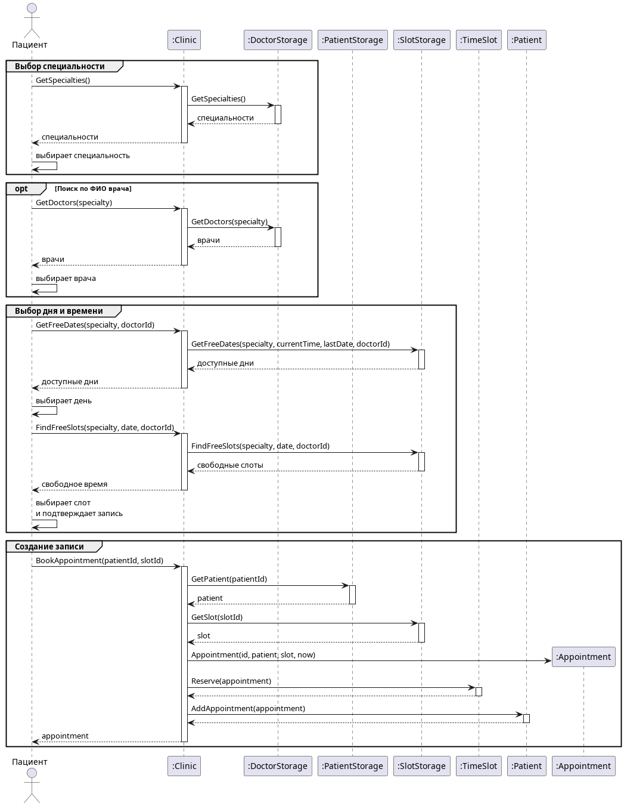
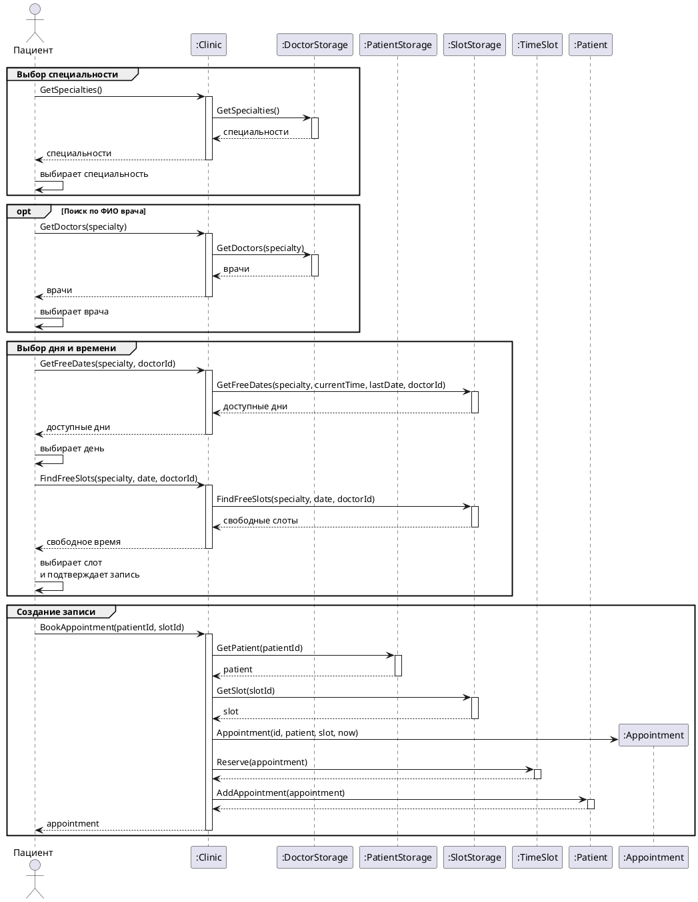

# Диаграмма последовательности «Запись на прием»

Выбор специальности, поиск по дате или врачу и запись пациента в текущем прототипе C#. Пациент, врач и слоты уже созданы. Описание прецедента находится в файле [«Запись на прием»](Запись%20на%20прием.md).

Пациент вызывает методы `Clinic`. Свободное время ищется в `SlotStorage`, а пациент берется из `PatientStorage`. Запись создает `Clinic`: он связывает новый `Appointment` с пациентом и слотом, занимает слот и сохраняет запись в обеих коллекциях. `Clinic` создает `PatientStorage`, `DoctorStorage` и `SlotStorage`. `DoctorStorage` возвращает специальности и врачей для начального выбора. При создании записи врач известен из выбранного слота.

## Операции записи

| Класс | Операция | Что делает |
| --- | --- | --- |
| `Clinic` / `DoctorStorage` | `GetSpecialties()` | Возвращает уникальные специальности зарегистрированных врачей по алфавиту |
| `Clinic` / `DoctorStorage` | `GetDoctors(specialty)` | Возвращает врачей выбранной специальности, отсортированных по ФИО |
| `Clinic` | `GetFreeDates(specialty, doctorId)` | Задает текущее время и горизонт записи, получает доступные дни из `SlotStorage` |
| `SlotStorage` | `GetFreeDates(specialty, after, dateTo, doctorId)` | Возвращает уникальные дни со свободными слотами внутри заданных границ, при необходимости только для выбранного врача |
| `Clinic` | `FindFreeSlots(specialty, date, doctorId)` | Проверяет горизонт в 14 дней, получает слоты из хранилища и исключает время, которое уже наступило |
| `SlotStorage` | `FindFreeSlots(specialty, date, doctorId)` | Отбирает свободные слоты по специальности, дате и необязательному врачу, сортирует результат |
| `Clinic` | `BookAppointment(patientId, slotId)` | Проверяет прикрепление, время слота, его доступность и активные записи пациента. Создает и сохраняет `Appointment` |
| `PatientStorage` | `GetPatient(patientId)` | Находит пациента по идентификатору или отклоняет запрос, если пациента нет |
| `Patient` | `HasActiveAppointment(specialty)` | Проверяет наличие записей той же специальности в состояниях `PLANNED` и `IN_PROGRESS` |
| `TimeSlot` | `Reserve(appointment)` | Проверяет доступность и закрепляет слот за созданной записью |
| `Patient` | `AddAppointment(appointment)` | Добавляет запись в список пациента |

`GetPatient`, `GetSlot`, `Reserve` и `AddAppointment` вызываются внутри реализации записи. `now` в конструкторе `Appointment` передает функцию получения времени.

Если `doctorId` не задан, дни и время ищутся среди всех врачей специальности. При поиске по ФИО пациент сначала выбирает врача, затем те же методы получают его идентификатор. Выбор специальности, даты и слота показан действиями пациента, без отдельных методов экранов. Результат поиска может устареть, поэтому `BookAppointment` повторяет проверки. До создания `Appointment` отказ не меняет данные. Бронирование выполняется синхронно под общей блокировкой `Clinic`, данные сохраняются в памяти программы. Ошибки передаются исключениями; экранов и интерактивной обработки ошибок нет.
