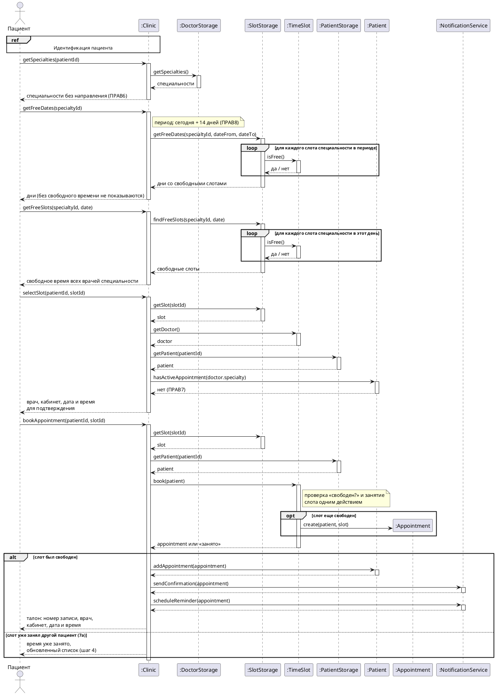
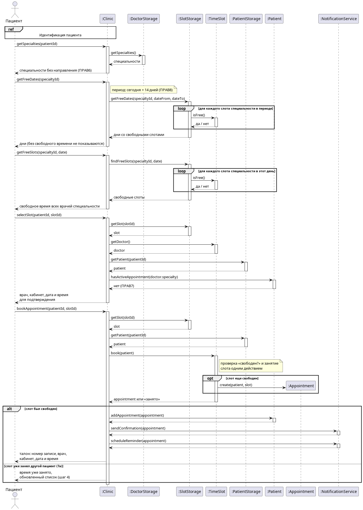

# Диаграмма последовательности «Запись на прием»

Основной успешный сценарий прецедента [«Запись на прием»](Запись%20на%20прием.md), шаги 1–8, и расширение 7а: слот успели занять, пока пациент подтверждал запись. Поиск по ФИО врача, отмена, перенос и остальные расширения описаны в тексте прецедента.

Пациент вызывает системные операции `:Clinic`. Через портал, приложение, инфомат или медрегистратора вызываются одни и те же операции, поэтому экранов на диаграмме нет. Расписание лежит в `:SlotStorage`: она находит свободные дни и слоты и отдает слот по номеру. Врач (`Doctor`) в записи не участвует. Слот сам знает своего врача и сам себя занимает (`book`).

Рис. Запись на прием 1. Диаграмма последовательности основного успешного сценария

Та же диаграмма картинкой, если plantuml не отображается:

## Системные операции

| Шаг сценария | Операция | Что делает |
| --- | --- | --- |
| 1 | включаемый прецедент «Идентификация пациента» | Пациент входит через ЕСИА, ПолиКлик определяет, кто он |
| 2 | `getSpecialties(patientId)` | Берет специальности из хранилища врачей и возвращает те, к которым можно записаться без направления (ПРАВ6) |
| 3 | `getFreeDates(specialtyId)` | Ищет в расписании на 14 дней вперед (ПРАВ8) дни, в которые хотя бы у одного врача специальности есть свободный слот |
| 4 | `getFreeSlots(specialtyId, date)` | Возвращает свободные слоты всех врачей специальности на выбранный день |
| 5 | `selectSlot(patientId, slotId)` | Проверяет, что у пациента нет активной записи к специальности врача этого слота (ПРАВ7), и возвращает врача, кабинет, дату и время для подтверждения |
| 6–8 | `bookAppointment(patientId, slotId)` | Занимает слот, если он еще свободен, создает запись со статусом «запланирована», отправляет подтверждение и планирует напоминание. Если слот уже занят, возвращает «занято» (7а) |
