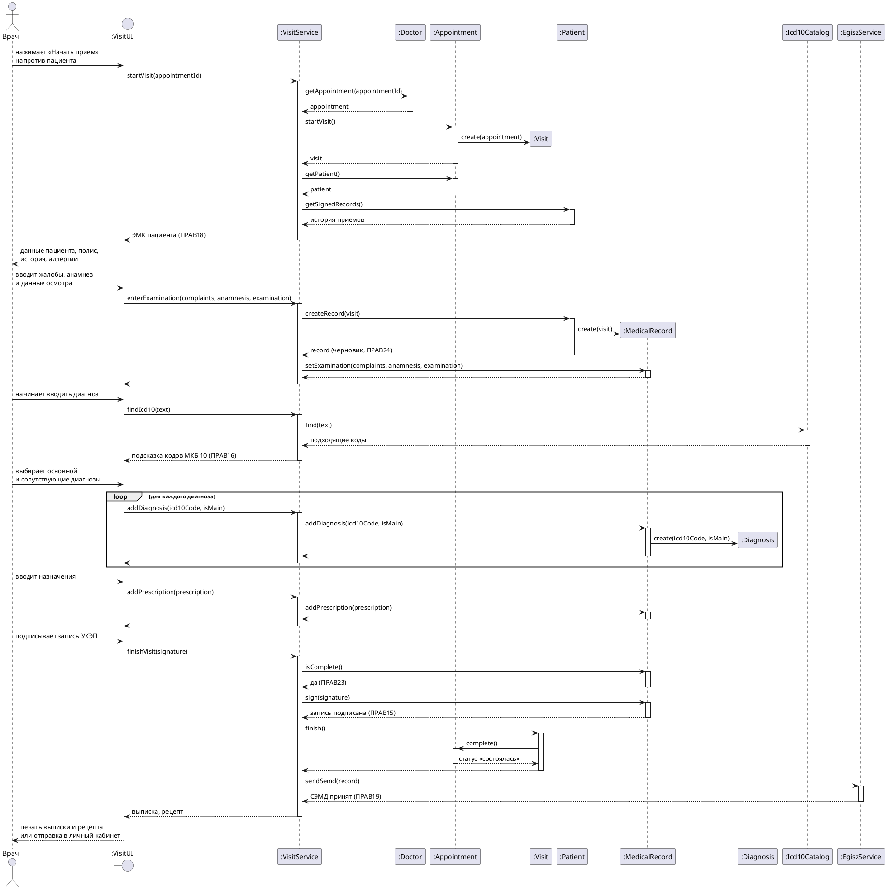
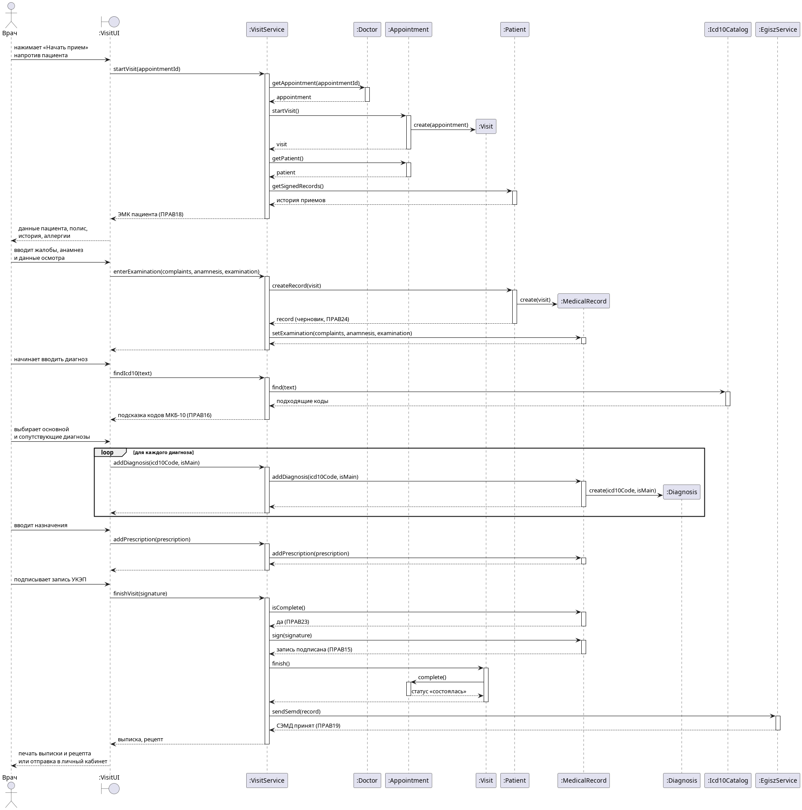

# Диаграмма последовательности «Прием пациента и ведение медкарты»

Основной успешный сценарий прецедента [«Прием пациента и ведение медкарты»](Прием%20пациента%20и%20ведение%20медкарты.md), шаги 1–9. Неявка, просмотр карты пациентом и остальные расширения описаны в тексте прецедента.

Врач работает на своем рабочем месте `:VisitUI`. Пациента, которому врач начинает прием, он берет из своего списка на день: этот список ведет прецедент «Электронная очередь». `:VisitService` открывается для вошедшего врача и хранит текущий визит между операциями. Поэтому после `startVisit` операции не передают идентификаторы. Запись на прием врач берет у `:Doctor`, где хранятся его слоты и записи на них. Записи ЭМК хранятся у пациента (`:Patient`).

Рис. Прием пациента 1. Диаграмма последовательности основного успешного сценария

Та же диаграмма картинкой, если plantuml не отображается:

## Системные операции

| Шаг сценария | Операция | Что делает |
| --- | --- | --- |
| 1–2 | `startVisit(appointmentId)` | Находит запись на прием у врача, создает визит и возвращает ЭМК пациента: врач видит ее, потому что пациент записан к нему (ПРАВ18) |
| 4 | `enterExamination(complaints, anamnesis, examination)` | Создает в ЭМК черновик записи (ПРАВ24) и сохраняет в нем жалобы, анамнез и данные осмотра |
| 5 | `findIcd10(text)` | Подсказывает коды по справочнику МКБ-10 (ПРАВ16) |
| 5 | `addDiagnosis(icd10Code, isMain)` | Добавляет в запись основной или сопутствующий диагноз |
| 6 | `addPrescription(prescription)` | Добавляет в запись назначение. Направления выдаются в расширении «Выдача направления» |
| 7–9 | `finishVisit(signature)` | Проверяет обязательные поля (ПРАВ23), подписывает запись УКЭП врача (ПРАВ15), завершает визит, меняет статус записи на прием на «состоялась», передает СЭМД в ЕГИСЗ (ПРАВ19) и возвращает выписку и рецепт |
