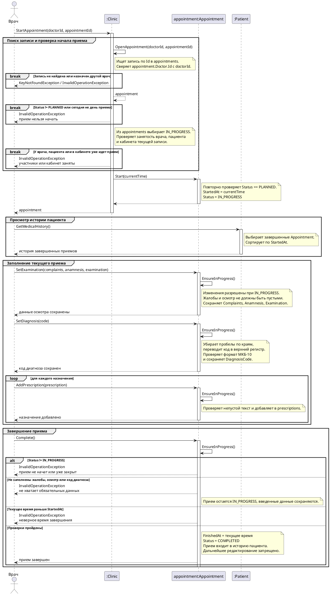

# Диаграмма последовательности «Прием пациента и ведение медкарты»

Реализованная часть прецедента [«Прием пациента и ведение медкарты»](Прием%20пациента%20и%20ведение%20медкарты.md): начало приема с проверками и отказами, просмотр истории, заполнение и завершение приема в памяти.

Врач один раз вызывает `Clinic.StartAppointment` и получает существующий `Appointment`, созданный при записи пациента. Дальше текущий прием хранится локально. Его методы заполняют данные без повторного поиска через `Clinic`. История берется у пациента этого приема (`appointment.Patient`).

## Операции приема

| Класс | Операция | Что делает |
| --- | --- | --- |
| `Clinic` | `StartAppointment(doctorId, appointmentId)` | Проверяет назначенного врача, статус записи, дату и занятость врача, пациента и кабинета. Начинает прием и возвращает тот же объект `Appointment` |
| `Patient` | `GetMedicalHistory()` | Возвращает завершенные приемы пациента в порядке времени начала |
| `Appointment` | `SetExamination(complaints, anamnesis, examination)` | Заполняет жалобы, анамнез и данные осмотра текущего приема |
| `Appointment` | `SetDiagnosis(code)` | Проверяет формат кода МКБ-10 и сохраняет один диагноз |
| `Appointment` | `AddPrescription(prescription)` | Добавляет назначение |
| `Appointment` | `Complete()` | Проверяет обязательные данные, фиксирует время окончания и статус `COMPLETED`, запрещает дальнейшее редактирование |

`Start(currentTime)` вызывается внутри `Clinic.StartAppointment`. Остальные изменения врач вносит в полученный `Appointment`. Закрытый `EnsureInProgress()` проверяет, что прием идет; его вызывают методы заполнения и завершения.

Блоки `break` прерывают сценарий, если начать прием нельзя. Ветки `alt` показывают результат отдельного вызова `Complete()`. Ошибки передаются как исключения; интерфейс их обработки в прототипе не реализован. На диаграмме заполнение показано для корректных данных: пустой текст, неверный код и неподходящий статус методы также отклоняют исключениями.

УКЭП, исправления подписанных документов, передача СЭМД в ЕГИСЗ и формирование выписки пока не реализованы. `Complete()` завершает прием в прототипе, но не подписывает медицинский документ.
