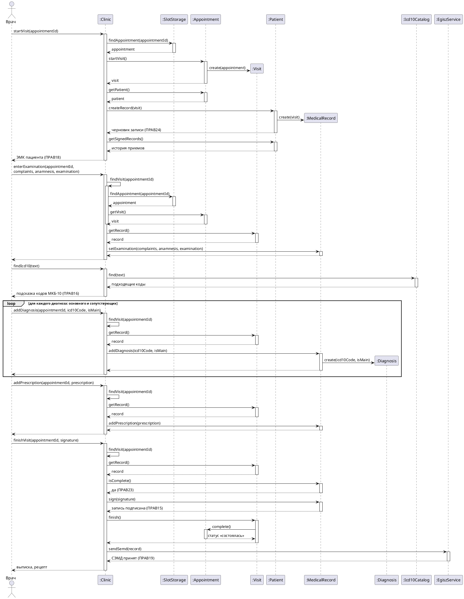

# Диаграмма последовательности «Прием пациента и ведение медкарты»

Основной успешный сценарий прецедента [«Прием пациента и ведение медкарты»](Прием%20пациента%20и%20ведение%20медкарты.md), шаги 1–9. Неявка, просмотр карты пациентом и остальные расширения описаны в тексте прецедента.

Врач вызывает системные операции `:Clinic`. Пациента, которого он принимает, врач берет из своего списка на день: этот список дает прецедент «Электронная очередь». `:Clinic` ничего не запоминает между операциями, поэтому каждая операция получает номер записи на прием `appointmentId`. Запись на прием `:Clinic` находит в расписании `:SlotStorage`. Визит берется у записи на прием, а запись ЭМК у визита. Этот поиск вынесен в закрытый метод `findVisit` и расписан один раз, в `enterExamination`. Записи ЭМК хранятся у пациента (`:Patient`).

Рис. Прием пациента 1. Диаграмма последовательности основного успешного сценария

Та же диаграмма картинкой, если plantuml не отображается:

## Системные операции

| Шаг сценария | Операция | Что делает |
| --- | --- | --- |
| 1–2 | `startVisit(appointmentId)` | Находит запись на прием в расписании, создает визит и черновик записи ЭМК (ПРАВ24), возвращает подписанные записи ЭМК пациента. Врач видит их, потому что пациент записан к нему (ПРАВ18) |
| 4 | `enterExamination(appointmentId, complaints, anamnesis, examination)` | Сохраняет в черновике жалобы, анамнез и данные осмотра |
| 5 | `findIcd10(text)` | Подсказывает коды по справочнику МКБ-10 (ПРАВ16) |
| 5 | `addDiagnosis(appointmentId, icd10Code, isMain)` | Добавляет в запись основной или сопутствующий диагноз |
| 6 | `addPrescription(appointmentId, prescription)` | Добавляет в запись назначение. Направления выдаются в расширении «Выдача направления» |
| 7–9 | `finishVisit(appointmentId, signature)` | Проверяет обязательные поля (ПРАВ23), подписывает запись УКЭП врача (ПРАВ15), завершает визит, меняет статус записи на прием на «состоялась», передает СЭМД в ЕГИСЗ (ПРАВ19) и возвращает выписку и рецепт |
