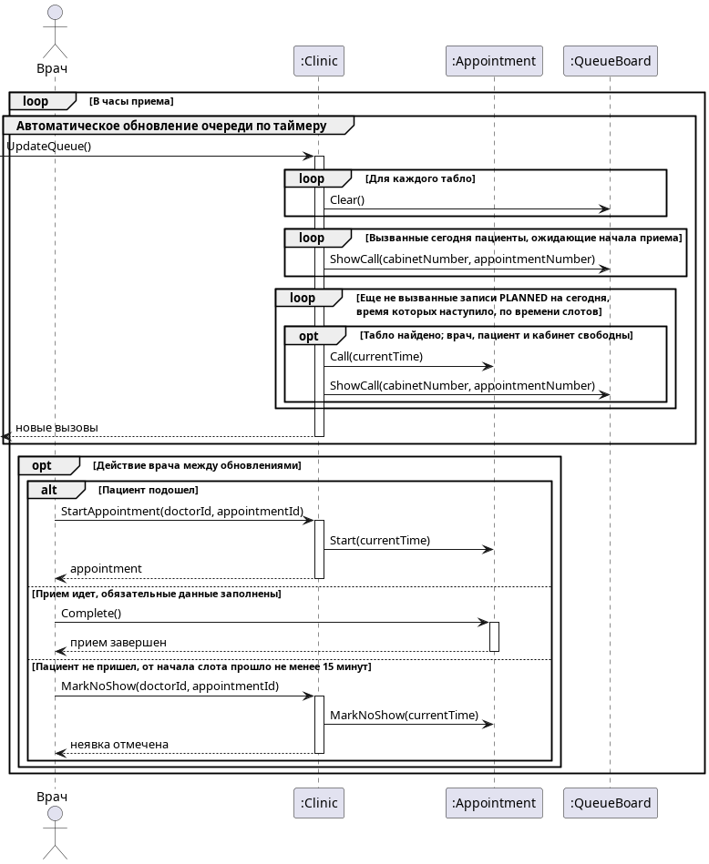
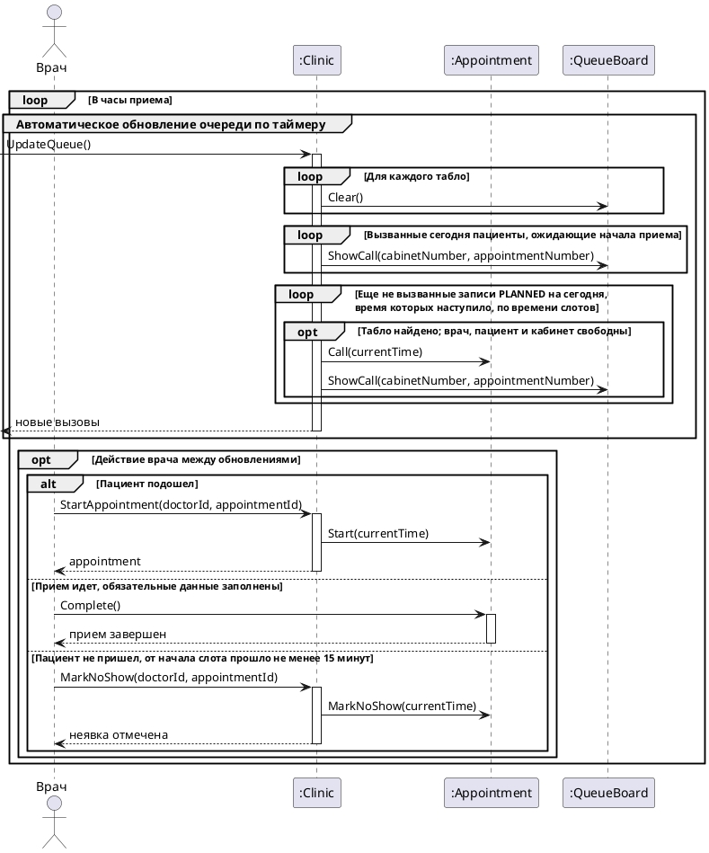

# Диаграмма последовательности «Электронная очередь»

Реализованная часть прецедента [«Электронная очередь»](Электронная%20очередь.md): автоматический выбор записей для вызова, обновление табло, начало и завершение приема, отметка неявки врачом.

В `QueueDemo` программа вызывает `Clinic.UpdateQueue()` по таймеру. `Clinic` берет записи из своего списка `appointments`, время из `Appointment.Slot.Start`, врача и кабинет из самой записи. Табло выбирается по `QueueBoard.CabinetNumbers`. Действия врача происходят между обновлениями очереди; полученный при начале приема `Appointment` хранится локально.

## Операции очереди

| Класс | Операция | Что делает |
| --- | --- | --- |
| `Clinic` | `UpdateQueue()` | Обновляет табло, сохраняет ожидающие вызовы, выбирает новые записи по времени с учетом занятости врача, пациента и кабинета. Возвращает только новые вызовы |
| `Appointment` | `Call(calledAt)` | Сохраняет время первого вызова в `CalledAt`. Запись остается `PLANNED` |
| `QueueBoard` | `Clear()` | Очищает текущие вызовы перед обновлением табло |
| `QueueBoard` | `ShowCall(cabinetNumber, appointmentNumber)` | Сохраняет номер записи для кабинета, который обслуживает табло |
| `Clinic` | `StartAppointment(doctorId, appointmentId)` | Проверяет условия начала приема, вызывает `Start(currentTime)` и возвращает существующий `Appointment` |
| `Appointment` | `Complete()` | Проверяет обязательные данные и завершает начатый прием со статусом `COMPLETED` |
| `Clinic` | `MarkNoShow(doctorId, appointmentId)` | Находит запись, проверяет назначенного врача и передает отметку неявки в `Appointment` |
| `Appointment` | `MarkNoShow(currentTime)` | Для записи `PLANNED` сохраняет статус `NO_SHOW`, если от начала слота прошло не менее 15 минут |

Ожидающий вызов на сегодня занимает врача, пациента и кабинет до начала приема или отметки неявки. При идущем приеме они также заняты. На следующем обновлении завершенный прием и неявка перестают блокировать очередь, а вызов снимается с табло. Повторное обновление сохраняет ожидающий вызов без нового сигнала.

В прототипе табло хранится в памяти: консоль читает `QueueBoard.Calls` и показывает номер записи и кабинет. Звуковой сигнал обозначен текстом `[сигнал]`. Просмотр списка врача, вызов выбранной записи, ручной повторный вызов и история последних вызовов описаны в прецеденте; на этой диаграмме показана реализованная часть.
