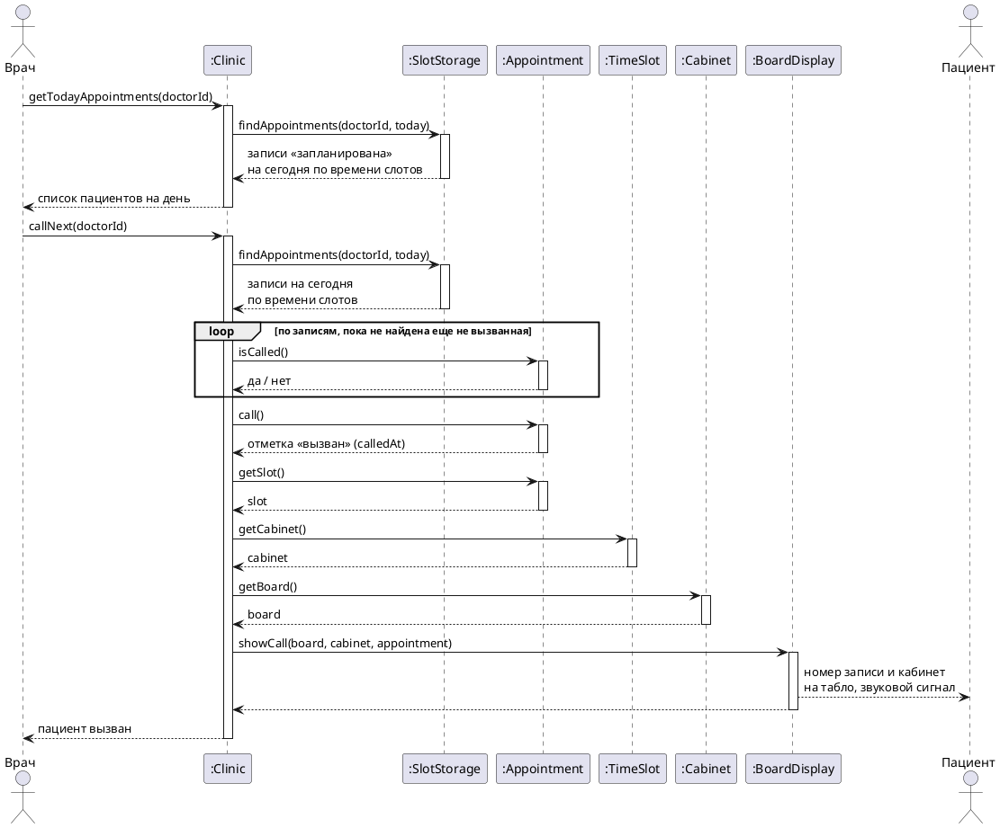

# Диаграмма последовательности «Электронная очередь»

Основной успешный сценарий прецедента [«Электронная очередь»](Электронная%20очередь.md), шаги 1–3. Вызов конкретного пациента, повторный вызов и остальные расширения описаны в тексте прецедента.

Врач вызывает системные операции `:Clinic`. Отдельного класса для очереди нет. Очередь к кабинету это записи врача на сегодня по времени слотов, их находит `:SlotStorage`, а вызов отмечается в самой записи `:Appointment`. Кабинет `:Clinic` узнает у слота, а табло у кабинета: одно табло стоит на группу из 3–4 кабинетов. Вызов на экран табло выводит `:BoardDisplay`.

Рис. Электронная очередь 1. Диаграмма последовательности основного успешного сценария

Та же диаграмма картинкой, если plantuml не отображается:

## Системные операции

| Шаг сценария | Операция | Что делает |
| --- | --- | --- |
| 1 | `getTodayAppointments(doctorId)` | Возвращает записи врача на сегодня со статусом «запланирована» в порядке времени слотов |
| 2–3 | `callNext(doctorId)` | Выбирает запись с самым ранним слотом из еще не вызванных, отмечает ее как вызванную и показывает номер записи и кабинет на табло группы кабинетов |
