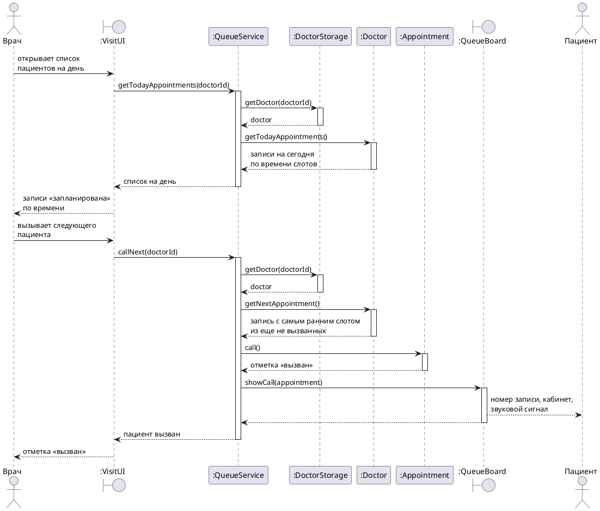
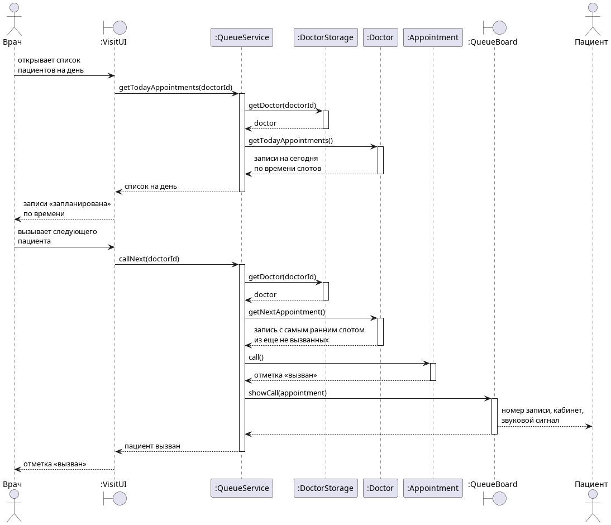

# Диаграмма последовательности «Электронная очередь»

Основной успешный сценарий прецедента [«Электронная очередь»](Электронная%20очередь.md), шаги 1–3. Вызов конкретного пациента, повторный вызов и остальные расширения описаны в тексте прецедента.

Врач работает со своего рабочего места `:VisitUI`, того же, с которого он потом ведет прием. Табло у кабинета `:QueueBoard` показывает вызов. Отдельного класса для очереди нет. Очередь к кабинету это записи врача на сегодня по времени слотов, а вызов отмечается в самой записи `:Appointment`. Записи на сегодня и следующую запись дает `:Doctor`, потому что у него хранятся слоты и записи на них.

Рис. Электронная очередь 1. Диаграмма последовательности основного успешного сценария

Та же диаграмма картинкой, если plantuml не отображается:

## Системные операции

| Шаг сценария | Операция | Что делает |
| --- | --- | --- |
| 1 | `getTodayAppointments(doctorId)` | Возвращает записи врача на сегодня со статусом «запланирована» в порядке времени слотов |
| 2–3 | `callNext(doctorId)` | Выбирает у врача запись с самым ранним слотом из еще не вызванных, отмечает ее как вызванную и показывает вызов на табло |
